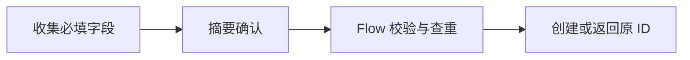

# 03 一句话申请

目标：一条经确认创建、返回真实编号且可回读的培训申请

视频：https://youtu.be/T-KbmUbzCOM

## 准备
- Copilot Studio、可调用的 Flow 与获准训练清单；检查连接、工具发布状态和字段映射。
- 仅使用练习数据。共享与跨账号身份检查另做验收，制作者自测不能替代。

## 路径

## 搭建
1. 建训练清单：按字段表设置 Requests；RequestKey 使用唯一值。核对实际内部列名。
2. 搭 Topic：收集字段并保存一次提交的稳定 RequestKey；摘要下设置确认、修改和取消。
3. 接 Flow：按蓝图配置输入 → 校验 → 查询同键 → 创建 / 返回原记录 → 失败输出。
4. 发布并映射：发布 Flow，添加 Agent 工具并逐项映射；仅确认分支调用写入。
5. 三处回读：对话编号、Flow 创建输出、清单同一 ID 的字段必须一致。

## 三组测试
### 正常：确认提交
输入或动作：我要申请 PDF 编辑软件，用来制作培训讲义，需要日期是 2026-11-02。

人工预期：收集齐后显示摘要；确认才调用；真实 ID 来自工具，且 Flow 与清单能回读同一记录。

实际结果：未测，请填写 test-record.csv 并留证。

### 异常：缺字段与取消
输入或动作：我要申请 PDF 编辑软件，制作培训讲义。
补齐日期后，在摘要选择“取消”。

人工预期：先追问日期；取消不调用写入，前后记录数量无新增。

实际结果：未测，请填写 test-record.csv 并留证。

### 变式：同键重试
输入或动作：在受控测试中，用同一次提交保存的 RequestKey 和完全相同的内容重试。

人工预期：返回原记录 ID，只保留一条；内容变更而沿用同键时提示冲突，重新提交使用新键。

实际结果：未测，请填写 test-record.csv 并留证。

## 作业
保存 Agent、工具与流程标识；以新业务测试一次正常和一次取消；准备跟进所需字段。

## 边界
课例为制作者受控训练路径；跨账号身份、并发与生产授权需另验。登记、审批和通知是不同状态。

资料为虚构练习；搭建蓝图不能一键导入。页面勾选仅是个人自检，平台通过须有实际运行和下游回读。
